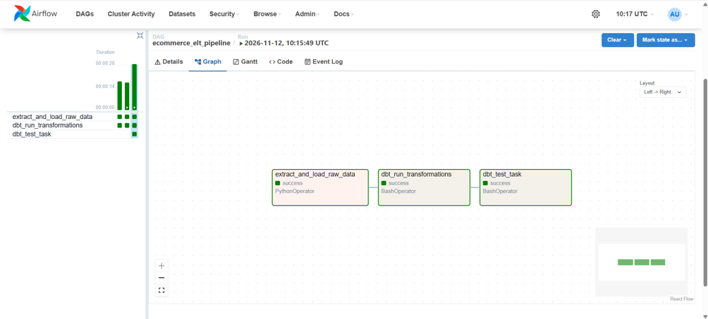

# Modern Data Stack Pet Shop

An end-to-end Data Engineering coursework project for a pet shop. It demonstrates data generation, loading into a PostgreSQL data warehouse, transformation with dbt, data quality checks, and workflow orchestration with Apache Airflow.

## Project overview

The project uses an ELT workflow:

1. **Generate and load data:** Python scripts create sample pet shop datasets and load them into PostgreSQL.
2. **Transform data:** dbt builds staging models and analytical marts.
3. **Test data quality:** dbt tests check selected data quality rules.
4. **Orchestrate the workflow:** Apache Airflow runs the tasks in the required order.

## Architecture

```text
Python data generator
        |
        v
PostgreSQL loader
        |
        v
PostgreSQL: petshop_dwh
        |
        | raw schema
        v
dbt staging models
        |
        v
dbt analytical marts
        |
        | analytics schema
        v
Analytical data

Apache Airflow DAG:
extract_and_load_raw_data
        |
        v
dbt_run_transformations
        |
        v
dbt_test_task
```

## Technology stack

| Technology | Purpose |
|---|---|
| Python | Generate and load sample data |
| PostgreSQL 15 | Store raw and transformed data |
| Docker | Run the database and Airflow environment |
| Apache Airflow 2.10.5 | Orchestrate the ELT workflow |
| dbt Core | Transform data and run data quality tests |
| dbt-postgres | Connect dbt to PostgreSQL |
| SQL / Jinja | Define transformation logic |

## Source datasets

The data generator creates the following datasets:

| Dataset | Records |
|---|---:|
| `pet_owners` | 50 |
| `brands` | 10 |
| `pet_supplies` | 100 |
| `transactions` | 500 |
| `loyalty_points` | 500 |
| `reviews` | 100 |

The source tables are stored in the PostgreSQL `raw` schema.

## dbt models

The dbt project contains two model layers.

### Staging

- `stg_users`
- `stg_orders`
- `stg_products`

Staging models prepare source data for further transformations.

### Marts

- `dim_users`
- `dim_products`
- `fct_orders`

The marts form an analytical layer based on a star-schema approach. The resulting models are stored in the `analytics` schema.

## Data quality tests

The `stg_users` model has two tests for the `user_id` column:

- `unique`: checks that identifiers are unique.
- `not_null`: checks that identifiers do not contain NULL values.

The tests are defined in `ecommerce_dbt/models/staging/schema.yml` and are executed with `dbt test`.

## Airflow orchestration

The DAG `ecommerce_elt_pipeline` is defined in `airflow/dags/ecommerce_pipeline.py`.

| Task | Operator | Description |
|---|---|---|
| `extract_and_load_raw_data` | PythonOperator | Generates sample data and loads it into PostgreSQL |
| `dbt_run_transformations` | BashOperator | Runs dbt models with `dbt run` |
| `dbt_test_task` | BashOperator | Runs data quality checks with `dbt test` |

The tasks run sequentially. Each task starts only after the previous task succeeds. The DAG is configured with a daily schedule (`@daily`) and `catchup=False`. It can also be triggered manually from the Airflow web interface.

## Project structure

```text
modern-datastack-petshop/
├── airflow/
│   └── dags/
│       ├── ecommerce_pipeline.py
│       └── scripts/
│           ├── data_generator.py
│           └── load_to_dwh.py
├── ecommerce_dbt/
│   ├── models/
│   │   ├── staging/
│   │   │   ├── src_ecommerce.yml
│   │   │   ├── schema.yml
│   │   │   ├── stg_users.sql
│   │   │   ├── stg_orders.sql
│   │   │   └── stg_products.sql
│   │   └── marts/
│   │       ├── dim_users.sql
│   │       ├── dim_products.sql
│   │       └── fct_orders.sql
│   ├── dbt_project.yml
│   └── profiles.yml
├── docker-compose.yml
├── requirements.txt
└── README.md
```

## Running the project

### Start PostgreSQL

From the project root, run:

```bash
docker compose up -d dwh_postgres
```

### Run dbt manually

Configure `ecommerce_dbt/profiles.yml` for your local PostgreSQL connection, then run:

```bash
dbt debug --project-dir ecommerce_dbt --profiles-dir ecommerce_dbt
dbt run --project-dir ecommerce_dbt --profiles-dir ecommerce_dbt
dbt test --project-dir ecommerce_dbt --profiles-dir ecommerce_dbt
```

### Run the Airflow pipeline

Start the Airflow environment with the project DAGs, scripts, and dbt project mounted into the container. Open [http://localhost:8080](http://localhost:8080), locate `ecommerce_elt_pipeline`, and trigger it manually.

## Execution result

The updated DAG was executed successfully in the Airflow environment. All three tasks completed with the `success` state:

- `extract_and_load_raw_data`
- `dbt_run_transformations`
- `dbt_test_task`



## Configuration notes

- Database: `petshop_dwh`
- Raw source schema: `raw`
- dbt output schema: `analytics`
- Keep local database credentials in the local dbt profile and do not commit secrets.

---

Created as a Data Engineering coursework project.
