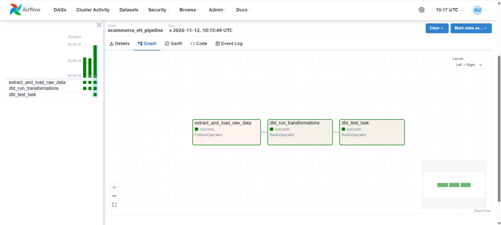

# Modern Data Stack Pet Shop

Навчальний проєкт з інженерії даних для зоомагазину. Проєкт демонструє повний ELT-процес: генерацію тестових даних, завантаження до сховища PostgreSQL, трансформацію за допомогою dbt, перевірку якості даних, оркестрацію процесів через Apache Airflow та побудову аналітичних візуалізацій у Metabase.

## Огляд проєкту

У проєкті реалізовано такий процес обробки даних:

1. **Генерація та завантаження даних.** Python-скрипти створюють тестові набори даних для зоомагазину та завантажують їх до PostgreSQL.
2. **Зберігання сирих даних.** Початкові таблиці розміщуються у схемі `raw`.
3. **Трансформація даних.** dbt створює staging-моделі та аналітичні таблиці.
4. **Перевірка якості.** Тести dbt перевіряють коректність вибраних даних.
5. **Оркестрація.** Apache Airflow керує послідовністю виконання етапів ELT.
6. **Аналітика та візуалізація.** Metabase підключається до сховища даних і використовується для створення графіків на основі аналітичної схеми.
7. **Документація та залежності.** dbt Docs генерує документацію моделей і граф Data Lineage.

## Архітектура

```text
Python: генерація даних
          |
          v
Python: завантаження даних
          |
          v
PostgreSQL: petshop_dwh
          |
          | схема raw
          v
dbt: staging-моделі
          |
          v
dbt: аналітичні моделі (marts)
          |
          | схема analytics
          v
Metabase: аналітичні графіки

Apache Airflow:
  extract_and_load_raw_data
          |
          v
  dbt_run_transformations
          |
          v
  dbt_test_task

dbt Docs:
  документація моделей та Data Lineage
```

## Технологічний стек

| Технологія | Призначення |
|---|---|
| Python | Генерація та завантаження тестових даних |
| PostgreSQL 15 | Зберігання сирих і трансформованих даних |
| Docker та Docker Compose | Запуск сервісів у контейнерах |
| Apache Airflow 2.10.5 | Оркестрація ELT-процесу |
| dbt Core | Трансформація даних і перевірка їхньої якості |
| dbt-postgres | Підключення dbt до PostgreSQL |
| SQL та Jinja | Опис логіки трансформації |
| Metabase | Створення аналітичних запитів і візуалізацій |

## Початкові набори даних

Генератор створює такі набори даних:

| Набір даних | Кількість записів |
|---|---:|
| `pet_owners` | 50 |
| `brands` | 10 |
| `pet_supplies` | 100 |
| `transactions` | 500 |
| `loyalty_points` | 500 |
| `reviews` | 100 |

Початкові таблиці зберігаються у схемі PostgreSQL `raw`.

## Моделі dbt

Проєкт dbt містить два рівні моделей.

### Staging

- `stg_users`
- `stg_orders`
- `stg_products`

Staging-моделі підготовлюють початкові дані до подальшої обробки: вибирають потрібні поля та формують зручну структуру для аналітичного рівня.

### Marts

- `dim_users`
- `dim_products`
- `fct_orders`

Аналітичний рівень побудований за підходом зіркової схеми. Виміри містять інформацію про користувачів і товари, а таблиця фактів містить дані про замовлення. Результати моделей зберігаються у схемі `analytics`.

## Перевірка якості даних

У проєкті налаштовано чотири тести dbt:

- для `stg_users.user_id`: `unique` та `not_null`;
- для `fct_orders.order_id`: `unique` та `not_null`.

Тести перевіряють унікальність ідентифікаторів та відсутність порожніх значень у ключових полях. Опис тестів розміщений у YAML-файлах моделей. Для запуску перевірок використовується команда `dbt test`.

## Оркестрація в Apache Airflow

DAG `ecommerce_elt_pipeline` описаний у файлі `airflow/dags/ecommerce_pipeline.py`.

| Завдання | Оператор | Призначення |
|---|---|---|
| `extract_and_load_raw_data` | PythonOperator | Генерує тестові дані та завантажує їх до PostgreSQL |
| `dbt_run_transformations` | BashOperator | Запускає трансформації dbt командою `dbt run` |
| `dbt_test_task` | BashOperator | Запускає перевірки якості даних командою `dbt test` |

Завдання виконуються послідовно: наступний етап починається після успішного завершення попереднього. DAG має щоденний розклад `@daily`, параметр `catchup=False), а також може запускатися вручну через вебінтерфейс Airflow.

## Аналітика у Metabase

Metabase підключений до бази даних `petshop_dwh) і використовує аналітичну схему `analytics`. У ньому створено дві візуалізації:

1. **Динаміка замовлень.** Лінійний графік кількості замовлень у часі з групуванням за місяцями.
2. **Топ-5 користувачів за кількістю замовлень.** Стовпчаста діаграма, побудована на основі об'єднання таблиць `fct_orders` та `dim_users`. Результати впорядковані за кількістю замовлень у спадному порядку.

Для запуску Metabase разом із PostgreSQL використовується сервіс `metabase` у файлі `docker-compose.yml). Вебінтерфейс Metabase доступний за адресою [http://localhost:3000](http://localhost:3000).

## Документація dbt та Data Lineage

Для генерації документації використовується команда:

```bash
dbt docs generate
```

Для перегляду документації запускається локальний сервер:

```bash
dbt docs serve --port 8081
```

Після запуску документація доступна за адресою [http://localhost:8081](http://localhost:8081). У розділі Data Lineage можна переглянути залежності між джерелами даних, staging-моделями та аналітичними моделями marts.

## Структура проєкту

```text
modern-datastack-petshop/
├── airflow/
│   └── dags/
│       ├── ecommerce_pipeline.py
│       └── scripts/
│           ├── data_generator.py
│           └── load_to_dwh.py
├── ecommerce_dbt/
│   ├── models/
│   │   ├── staging/
│   │   │   ├── src_ecommerce.yml
│   │   │   ├── schema.yml
│   │   │   ├── stg_users.sql
│   │   │   ├── stg_orders.sql
│   │   │   └── stg_products.sql
│   │   └── marts/
│   │       ├── schema.yml
│   │       ├── dim_users.sql
│   │       ├── dim_products.sql
│   │       └── fct_orders.sql
│   ├── dbt_project.yml
│   └── profiles.yml
├── docs/
│   └── airflow_dag_graph.png
├── docker-compose.yml
├── requirements.txt
└── README.md
```

## Запуск проєкту

### Запуск PostgreSQL та Metabase

З кореневої папки проєкту виконайте:

```bash
docker compose up -d dwh_postgres metabase
```

Після запуску:
- PostgreSQL доступний на порту `5432);
- Metabase доступний за адресою [http://localhost:3000](http://localhost:3000).

Під час першого запуску Metabase потрібно пройти початкове налаштування та додати підключення PostgreSQL. Якщо Metabase працює в Docker Compose в одній мережі з базою, як адресу хоста потрібно вказати `dwh_postgres), порт `5432) і назву бази `petshop_dwh).

### Запуск dbt

Перед запуском налаштуйте локальний файл `ecommerce_dbt/profiles.yml` відповідно до свого середовища. Якщо dbt запускається безпосередньо у Windows, а PostgreSQL опублікований на локальний порт `5432), як адресу хоста можна використовувати `localhost`.

З активованим Python virtual environment виконайте з кореневої папки проєкту:

```bash
dbt debug --project-dir ecommerce_dbt --profiles-dir ecommerce_dbt
dbt run --project-dir ecommerce_dbt --profiles-dir ecommerce_dbt
dbt test --project-dir ecommerce_dbt --profiles-dir ecommerce_dbt
```

Для генерації та перегляду документації перейдіть до папки `ecommerce_dbt` і виконайте:

```bash
dbt docs generate
dbt docs serve --port 8081
```

### Запуск конвеєра Airflow

Запустіть середовище Airflow з підключеними DAG, скриптами та проєктом dbt. Вебінтерфейс Airflow доступний за адресою [http://localhost:8080](http://localhost:8080). Знайдіть DAG `ecommerce_elt_pipeline` і запустіть його вручну.

## Результати виконання

DAG було успішно виконано в середовищі Airflow. Усі три завдання завершилися зі статусом `success`:

- `extract_and_load_raw_data`;
- `dbt_run_transformations`;
- `dbt_test_task`.



У Metabase створено два аналітичні графіки: динаміку замовлень за місяцями та топ-5 користувачів за кількістю замовлень. Документацію dbt згенеровано, граф Data Lineage доступний у розділі DAG.

## Основні параметри конфігурації

- Назва бази даних: `petshop_dwh`.
- Схема початкових даних: `raw`.
- Схема аналітичних моделей: `analytics`.
- Порт PostgreSQL: `5432`.
- Порт Metabase: `3000).
- Порт Airflow: `8080) (за умови відповідної конфігурації середовища).
- Порт сервера документації dbt у наведеній команді: `8081).

Локальні облікові дані та паролі не слід зберігати у відкритому вигляді в репозиторії. Для власного запуску використовуйте локальні налаштування підключення.

---

Навчальний проєкт з інженерії даних, присвячений побудові сучасного стека обробки та аналітики даних для зоомагазину.
